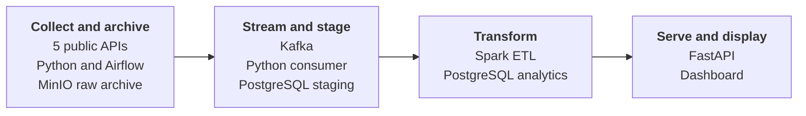

# World in Motion: An an End-to-End Data Pipeline for Global Natural Disaster Monitoring

A DSAI5102 Data Architecture & Engineering project for exploring recent global hazards. It combines earthquake reports, disaster alerts, satellite fire detections, curated events, and site forecasts in the **World in Motion** dashboard.

## Run locally

You need Docker with Compose, Python 3.10 or later, and a free [NASA FIRMS MAP_KEY](https://firms.modaps.eosdis.nasa.gov/api/map_key/). Start Docker Desktop if you use it. Run all commands from the repository root, the folder that contains `docker-compose.yml`.

1. **Configure the environment.** Create `.env` on first setup. This command preserves an existing file.

   ```bash
   test -f .env || cp .env.example .env
   ```

   Open `.env`, set `FIRMS_MAP_KEY`, and replace the PostgreSQL password, MinIO password, and `AIRFLOW_SECRET` placeholders. Git ignores the populated file. [Environment template](.env.example)

2. **Start the pipeline.** The first build downloads the service images and may take several minutes.

   ```bash
   docker compose up -d --build
   ```

   Check the backend. A ready API returns a JSON response with `"status":"ok"`.

   ```bash
   curl -fsS http://127.0.0.1:8000/api/v1/health
   ```

3. **Start the dashboard.** Keep this terminal running. The dashboard server uses Python's standard library.

   ```bash
   python3 dashboard/server.py
   ```

   Open [World in Motion at http://127.0.0.1:5173](http://127.0.0.1:5173). Charts populate after source ingestion and the first Spark processing run. Spark is scheduled every 15 minutes.

### Check, rerun, or stop

| What you need | Where to look or what to run |
|---|---|
| API routes and filters | [FastAPI interactive docs](http://127.0.0.1:8000/docs) |
| Workflow status and task logs | [Airflow UI](http://127.0.0.1:8080) |
| Raw responses or Spark job status | [MinIO console](http://127.0.0.1:9001) · [Spark master UI](http://127.0.0.1:8081) |
| Dashboard says **API offline** | Check `docker compose ps`, then inspect `docker compose logs --tail=50 api` and retry the health check. |
| An image pull times out | Retry the affected service separately, for example `docker compose pull postgres` or `docker compose pull spark-master`. Then repeat the pipeline startup command. |
| Run a workflow manually | Use `docker compose exec airflow airflow dags trigger <dag_id>`. Available IDs are `ingest_firms`, `ingest_eonet`, `ingest_openmeteo`, `spark_etl`, and `daily_validation`. |

On a fresh database, Open-Meteo can skip a run while the cleaned event tables have no eligible locations. Its next run uses available sites after Spark loads the event records.

To stop locally, press **Ctrl+C** in the dashboard terminal, then run `docker compose down`. Docker keeps the named data volumes for the next start.

## Architecture



Python polls USGS and GDACS continuously. Airflow schedules FIRMS, EONET, and Open-Meteo, which uses coordinates from cleaned events. MinIO retains the original responses. Kafka buffers new or revised records, and the consumer stores them in PostgreSQL staging. Spark standardizes timestamps and hazard types, validates data, and builds daily event counts and 0.5° fire grids. FastAPI serves PostgreSQL results to the dashboard. A daily Airflow workflow checks freshness, backlog, and reconciliation.

## Dashboard

Use **Event Trend** to compare daily records and **Events by Hazard** to see the category mix. Filter by time period, hazard, region, or GDACS International aid level. Switch the map between **Events** and **Hotspots** and select an event to view details and available weather forecasts.

The event charts count source records by UTC day. Multiple feeds can describe the same incident. The Hotspots map measures satellite detections across the selected dates and region.

## Repository guide

| Path | Purpose |
|---|---|
| [`app/`](app/) | Source ingestion, Kafka consumer, and REST API |
| [`dags/`](dags/) and [`spark/etl.py`](spark/etl.py) | Scheduled workflows, data validation, and Spark transformations |
| [`sql/`](sql/) | PostgreSQL schema, indexes, and analytics views |
| [`dashboard/`](dashboard/) | Dashboard UI and local Python server |
| [`docker-compose.yml`](docker-compose.yml) and [`docker/`](docker/) | Service definitions and application images |

The [technical report](report.md) covers design choices, the data model, results, and limitations. The [API preflight](API_PREFLIGHT.md) and [implementation log](IMPLEMENTATION_STATUS.md) record verification runs.

## Dashboard credits

- World basemap provided by [Natural Earth](https://www.naturalearthdata.com/downloads/50m-raster-data/50m-natural-earth-1/).
- Map and heat layer provided by [Leaflet](https://leafletjs.com/) and [Leaflet.heat](https://github.com/Leaflet/Leaflet.heat). [Leaflet license](dashboard/public/assets/leaflet.LICENSE) · [Leaflet.heat license](dashboard/public/assets/leaflet-heat.LICENSE)
- Manrope typography. [SIL Open Font License](dashboard/public/assets/manrope.LICENSE)
