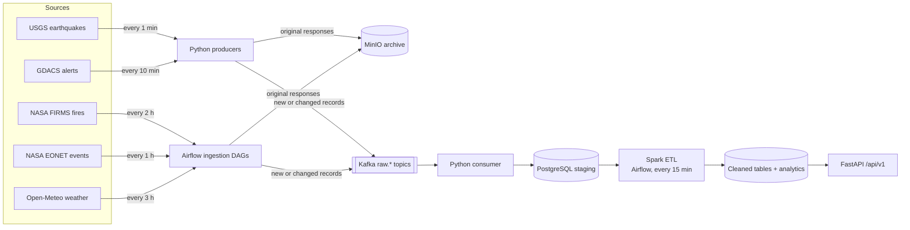
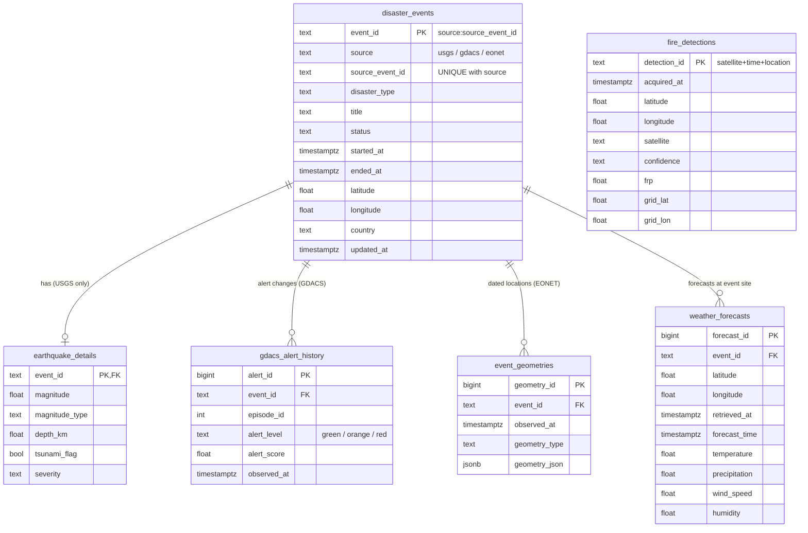

# Natural Disaster Data Pipeline

University project for DSAI5102 Data Architecture & Engineering. The pipeline collects live natural-disaster data from five public APIs,
streams it through Kafka, cleans it with Spark, stores it in PostgreSQL and serves it through a FastAPI REST API.

**Stack:** Kafka · Airflow · Spark · PostgreSQL · MinIO · FastAPI · Python · Docker Compose

## Overall flow



1. **Ingest.** Each source is requested on its schedule. The original response is archived in MinIO. Each record gets a stable ID and a content hash, and only **new or changed** records are published to Kafka.
2. **Stage.** One consumer writes Kafka messages to `staging.source_records`. It commits Kafka offsets only after the database write, and duplicates are ignored.
3. **Transform.** Spark parses UTC timestamps, standardises disaster categories, validates coordinates and numeric values, deduplicates, and keeps revision history (GDACS alert levels, EONET geometries). It also builds analytics such as daily counts and a 0.5° fire grid. Re-running it is idempotent.
4. **Serve.** FastAPI reads only PostgreSQL and never calls the external APIs.
5. **Validate.** A daily Airflow DAG checks data freshness and the ETL backlog, and reconciles staging against the final tables.

## Database (cleaned layer)



- `fire_detections` is intentionally **not linked** to `disaster_events`. Satellite hotspots are thermal anomalies, not confirmed wildfires.
- USGS, GDACS and EONET events are kept separate. They are not merged across sources.
- Other schemas:
  - `staging.source_records` holds raw JSONB, one row per record version.
  - `ops.ingestion_runs`, `ops.published_records` and `ops.validation_results` hold ingestion metadata.
  - The analytics schema has two Spark-built tables (`daily_event_counts`, `daily_fire_grid`) and three views (`active_alerts`, `latest_event_weather`, `source_freshness`).
- Full DDL: [`sql/01_schema.sql`](sql/01_schema.sql)

## REST API

Base URL `http://localhost:8000/api/v1`. Interactive docs are at `http://localhost:8000/docs`.

| Endpoint | Description | Filters |
|---|---|---|
| `GET /health` | API and database status | |
| `GET /events` | Disaster events from all sources | `source`, `disaster_type`, `status`, `from`, `to`, `bbox`, `limit`, `offset` |
| `GET /events/{event_id}` | One event with earthquake details, alert history and geometries | |
| `GET /earthquakes` | USGS earthquakes | `min_magnitude`, `max_magnitude`, `max_depth_km`, `severity`, `from`, `to`, `bbox` |
| `GET /alerts/active` | Current GDACS alerts with latest level | `alert_level`, `disaster_type`, `bbox` |
| `GET /fires/heatmap` | Daily 0.5° fire grid (count, avg/max FRP) | `day`, `from`, `to`, `min_count`, `bbox` |
| `GET /fires/detections` | Individual satellite fire detections | `from`, `to`, `confidence`, `min_frp`, `bbox` |
| `GET /weather` | Latest forecast per event, or hourly forecast for one event | `event_id`, `from`, `to` |
| `GET /analytics/daily` | Daily event counts by source and type | `source`, `disaster_type`, `from`, `to` |
| `GET /system/freshness` | Last ingestion and processing time per source | |

`bbox` = `west,south,east,north`. All times are UTC ISO-8601. Example: `/earthquakes?min_magnitude=4.5&bbox=120,-10,160,10`

## Run it

Requires Docker Desktop and a free [NASA FIRMS MAP_KEY](https://firms.modaps.eosdis.nasa.gov/api/map_key/).

```bash
cp .env.example .env            # add FIRMS_MAP_KEY and passwords
python scripts/check_apis.py    # optional live API check
docker compose up -d --build    # start everything
docker compose down             # stop (add -v to delete data)
```

| UI | URL |
|---|---|
| FastAPI docs | http://localhost:8000/docs |
| Airflow | http://localhost:8080 |
| MinIO console | http://localhost:9001 |
| Spark master | http://localhost:8081 |

Manual runs: `docker compose exec airflow airflow dags trigger <dag>` with `ingest_firms`, `ingest_eonet`, `ingest_openmeteo`,
`spark_etl` or `daily_validation`. For a one-off USGS or GDACS run: `docker compose exec producer-usgs python ingest.py usgs`.

## Project files

| Path | Purpose |
|---|---|
| `app/ingest.py` | Ingestion for all 5 sources (request → MinIO → parse → Kafka) |
| `app/consumer.py` | Kafka → PostgreSQL staging |
| `app/api.py` | FastAPI endpoints |
| `spark/etl.py` | PySpark ETL (`events`, `fires`, `weather`) |
| `dags/` | Airflow DAGs: ingestion, Spark ETL, daily validation |
| `sql/` | Schema, constraints, indexes, views |
| `docker-compose.yml`, `docker/` | Infrastructure |

Notes:
- MinIO runs from `pgsty/minio` (a community MinIO fork that still includes the web console), because official MinIO community images are no longer published.
- Airflow starts Spark jobs with `spark-submit` against the standalone Spark cluster.
- Test results: [`IMPLEMENTATION_STATUS.md`](IMPLEMENTATION_STATUS.md) and [`API_PREFLIGHT.md`](API_PREFLIGHT.md).
