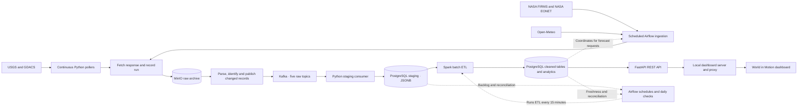
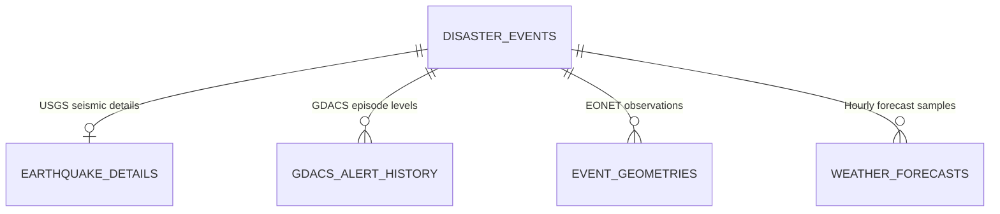

# Natural Disaster Data Pipeline

**DSAI5102 Data Architecture & Engineering · Technical reference for the final report**

The project collects five public feeds, archives the original responses, streams changed records through Kafka, transforms them with Spark, and serves the results from PostgreSQL through a REST API and an interactive dashboard. This reference covers the working repository at commit `9238359` with the documentation edits present at the time of review. The dashboard results in Section 5 come from a read-only database snapshot on **23 November 2026 at 07:40:51 Qatar time (04:40:51 UTC)**.

## 1. Problem statement and datasets

### Problem and motivation

Natural hazard information arrives in several formats and at different speeds. Earthquake feeds describe individual seismic events, alert feeds update the severity of an incident, satellites report individual heat detections, and forecast APIs return hourly values for a location. An analyst comparing these feeds needs to reconcile timestamps, retain source identifiers, handle revisions, and understand whether an apparent change reflects hazard activity or reporting coverage.

The project addresses this with a repeatable workflow for maintaining a queryable view of recent hazard records. A user can see which hazard types dominate a selected period, inspect the reports behind an activity peak, compare the current GDACS alert mix, examine concentrations of satellite detections, and view forecast context near selected events. This is a situational-awareness and data engineering prototype. Its outputs support exploration of the recorded data and depend on the source feeds' coverage, update timing, and definitions.

### Source inventory

| Source | Endpoint and default collection scope | Fields and record grain | Collection cadence |
|---|---|---|---|
| USGS earthquake feed | GeoJSON `summary/all_day.geojson`, a rolling past-day feed | One seismic record per USGS `id`. The system reads location, depth, magnitude and type, start and update timestamps, review status, title, and tsunami flag. | Continuous Python poller every 60 seconds |
| Global Disaster Awareness and Coordination System (GDACS) | GeoJSON `Events/geteventlist/search` for earthquake, tropical cyclone, flood, volcano, drought, and wildfire. The query starts seven UTC days before today and ends tomorrow, with all three alert levels. Each page requests 100 records with a limit of 50 pages. | One source event keyed by hazard code plus event ID. Episode ID, level, score, dates, country, and available point coordinates support alert monitoring and revision tracking. | Continuous Python poller every 10 minutes |
| NASA FIRMS | Area CSV, `VIIRS_NOAA20_NRT`, default area `world` and two UTC dates (today and yesterday). The source requires a MAP_KEY. | One satellite heat detection keyed by satellite, acquisition date and time, and coordinates. Includes confidence, fire radiative power (FRP), brightness, instrument, and day/night flag. | Airflow every two hours |
| NASA EONET | JSON `api/v3/events` with `status=all` and a default 30-day window | One curated event per EONET ID, with a title, categories, optional closure timestamp, and zero or more dated geometry observations. | Airflow hourly |
| Open-Meteo | JSON `v1/forecast` for eligible disaster locations, three forecast days in UTC, up to 50 coordinates per request | One archived payload per event per distinct forecast content, later expanded to hourly temperature, precipitation, wind speed, and relative humidity. | Airflow every three hours |

The upstream documentation explains the original data formats and field definitions. The lookback windows and schedules above are choices in this repository. [USGS GeoJSON feed](https://earthquake.usgs.gov/earthquakes/feed/v1.0/geojson.php) · [GDACS API quick start](https://www.gdacs.org/Documents/2025/GDACS_API_quickstart_v2.pdf) · [NASA FIRMS area API](https://firms.modaps.eosdis.nasa.gov/api/area/) · [NASA EONET v3 documentation](https://eonet.gsfc.nasa.gov/docs/v3) · [Open-Meteo forecast API](https://open-meteo.com/en/docs) · [Ingestion code](app/ingest.py)

The three event feeds contribute **source-specific event records**. Two sources may describe the same physical incident, so summing their rows measures reports in the pipeline. FIRMS contributes **satellite detection records**, whose positions and acquisition times represent detected thermal activity. A fire can produce multiple observations, and other heat sources can produce detections. Open-Meteo contributes **forecast hours tied to selected event sites**. These are model forecasts for a location and valid time. [NASA FIRMS product overview](https://www.earthdata.nasa.gov/s3fs-public/2023-03/FIRMS_OnePager_2022_Prnt-Web.pdf) · [Open-Meteo forecast API](https://open-meteo.com/en/docs) · [Cleaned schema](sql/01_schema.sql)

## 2. Architecture overview

### End-to-end data flow



> **Diagram caption.** The hybrid pipeline fetches fast feeds continuously and slower feeds on a schedule. All five sources share the same archive, message transport, and staging path. Scheduled Spark jobs turn staged records into analytics and API responses. The cleaned event table feeds coordinates back into Open-Meteo ingestion.

**Streaming and batch boundaries.** Kafka streams individual changed records from producers to the staging consumer. The larger JSON and CSV responses stay in MinIO. Spark reads finite PostgreSQL batches every 15 minutes via JDBC. The main transformation workflow is scheduled batch ETL with streaming transport upstream. Airflow orchestrates the three slower source jobs, Spark, and validation. [Compose services](docker-compose.yml) · [Ingestion DAGs](dags/ingestion_dags.py) · [Spark DAG](dags/spark_etl.py) · [Validation DAG](dags/daily_validation.py)

### Relational model at a glance



`disaster_events` stores one current row per source event. The four dependent tables keep optional details and time-varying records at their own grain. `fire_detections` is an independent fact table keyed by satellite measurement. Spark derives daily event counts and daily FIRMS grid statistics. PostgreSQL views expose current alerts, event forecasts, and source freshness. [DDL, indexes, and views](sql/01_schema.sql)

## 3. Design choices and justification

The rationale below explains what each component enables in this implementation. The performance observations in Section 5 are scoped to the recorded local runs.

| Technology or method | Implementation and rationale |
|---|---|
| **Python 3.10** with Requests, Confluent Kafka client, MinIO SDK, and psycopg2 | Shared collection code handles GeoJSON, JSON, and CSV for both continuous pollers and Airflow tasks. Using the same parser and change detection in both paths gives each source a consistent record envelope and archive workflow. |
| **Apache Kafka 4.1.2** | A topic per source separates offsets and traffic. Buffering lets the producers, PostgreSQL staging writer, and scheduled ETL run independently. Stable record IDs serve as message keys. The local broker combines the KRaft broker and controller roles, with one partition and one replica per topic to keep deployment small. |
| **MinIO S3-compatible object storage** | Retains compressed upstream responses and request metadata for audit and possible reprocessing. This preserves original records in their source formats and keeps the Kafka messages small. Compose pins the image to `pgsty/minio:RELEASE.2026-08-04T00-00-00Z`. |
| **Apache Airflow 3.3.2** | Makes ingestion cadence, dependencies, retries, task logs, and manual reruns visible. The forecast DAG selects sites before fetching data. The Spark DAG identifies each transformation as a separate task, and validation has its own schedule. The local deployment uses `standalone` with `LocalExecutor`. |
| **Apache Spark and PySpark 3.5.8** | Explicit schemas, Spark SQL expressions, window functions, array expansion, joins, and aggregations transform mixed source formats into analytics-ready rows. A standalone master and worker keep processing separate from ingestion and serving. JDBC connects Spark to PostgreSQL, and a driver-side SQL transaction performs the relational upserts. |
| **PostgreSQL 16** | JSONB staging accepts heterogeneous source records. Typed relational tables enforce keys, coordinate bounds, and relationships. Precomputed summaries reduce repeated dashboard aggregation, and ordinary views expose derived operational data. The same server hosts a separate Airflow metadata database. |
| **FastAPI and Uvicorn** | HTTP resources expose stored data independently of the source API schedules. FastAPI validates typed query arguments and publishes interactive OpenAPI docs. A shared query helper binds filter values and supplies a common pagination response. |
| **HTML, CSS, JavaScript, Canvas, and Leaflet** | A lightweight dashboard shows maps, trends, alert status, and forecasts together. Canvas renders the daily trend and sparklines. Leaflet renders the map using a bundled Natural Earth basemap and a heatmap plugin. A standard-library Python server serves the files and forwards API requests on the same browser origin. |
| **Docker Compose** | Versioned image definitions, service names, health dependencies, bind-mounted code, and persistent volumes make the multi-service environment reproducible on a local host. An environment template documents settings and keeps the real configuration outside Git. |

The application image pins Requests `2.34.2`, confluent-kafka `2.16.1`, minio `7.2.20`, psycopg2-binary `2.9.13`, FastAPI `0.162.4`, and Uvicorn `0.54.0`. The Airflow image includes the PostgreSQL JDBC connector `42.7.8` and Java 17. The ETL command finds Java on the container's PATH so the Spark job can run on Apple Silicon and x86 images. The standalone Spark worker has two cores and 2 GB of worker memory, with each submitted job capped at one core and a 1 GB executor. These settings describe the coursework deployment size. [Application Dockerfile](docker/app.Dockerfile) · [Airflow Dockerfile](docker/airflow.Dockerfile) · [Spark DAG](dags/spark_etl.py) · [Compose configuration](docker-compose.yml) · [Spark JDBC documentation](https://spark.apache.org/docs/3.5.8/sql-data-sources-jdbc.html)

## 4. Implementation details

### 4.1 Fetch, archive, and track revisions

1. **Fetch.** The continuous producers call the shared Python ingestion entry point. The scheduled jobs call the same functions as Airflow tasks. The ingestion HTTP helper allows up to three attempts, uses a 60-second timeout per request, and waits five seconds between failures. The producer subtracts runtime from the next polling delay. GDACS stops on an empty or partial page. The FIRMS parser checks for a CSV header because upstream can send a text error with HTTP 200. Request errors mask the FIRMS key.
2. **Register and archive.** An ingestion run receives a source-and-UTC timestamp ID. The original JSON/CSV bodies are written as gzip objects to `raw-archive/<source>/<YYYY>/<MM>/<DD>/<run_id>/page_###.<format>.gz`. The adjacent `request.json` records the source, fetch time, and optional ordered site list. `ops.ingestion_runs` tracks run status, archive prefix, page and byte counts, parsed and published counts, and error text.
3. **Parse and hash.** Each parser outputs a dictionary keyed by the stable source identifier. SHA-256 over JSON with sorted keys detects payload changes with the same ID. Open-Meteo results are paired with locations by request order, and generation timing metadata is excluded from the hashed payload. Comparing with `ops.published_records` allows an overlapping poll to publish only new or changed versions.
4. **Publish and acknowledge.** Kafka messages contain `source`, `record_id`, `content_hash`, `fetched_at`, `run_id`, `archive_prefix`, and `payload`. Producers set `acks=all` and enable idempotence. The publisher waits for delivery and updates recorded hashes only after Kafka confirms the batch. At this deployment size the in-sync set has one replica. If Kafka accepts records before a later failure recording their hashes, another poll can send them again. [Kafka producer acknowledgment and idempotence settings](https://kafka.apache.org/41/configuration/producer-configs/)

[Shared ingestion code](app/ingest.py) · [Ingestion run schema](sql/01_schema.sql) · [Source preflight script](scripts/check_apis.py)

### 4.2 Message consumption and staging

`kafka-init` creates `raw.usgs`, `raw.gdacs`, `raw.firms`, `raw.eonet`, and `raw.openmeteo` after the broker becomes healthy. The `staging-writer` consumer group reads up to 2,000 messages per call. It checks that the JSON envelope contains its required fields and that the source matches the topic. A psycopg2 bulk insert writes the payload as JSONB along with timestamps, run ID, partition, and offset. The unique key on `(source, record_id, content_hash)` makes a repeat of the same payload version a no-op.

The consumer commits its Kafka offsets synchronously **after** PostgreSQL commits. A crash between the two commits can cause replay, which the staging key absorbs. This gives at-least-once transport with deduplication at the write boundary. A staging row can be traced to the archived request through its run ID and to the Kafka message through its partition and offset. [Consumer implementation](app/consumer.py) · [Staging DDL](sql/01_schema.sql) · [Kafka service configuration](docker-compose.yml)

### 4.3 Airflow scheduling and dependencies

| DAG | Cron in the workflow configuration | Task flow |
|---|---|---|
| `ingest_firms` | `0 */2 * * *` | Fetch and archive → publish changed FIRMS records |
| `ingest_eonet` | `5 * * * *` | Fetch and archive → publish changed EONET records |
| `ingest_openmeteo` | `20 */3 * * *` | Select eligible event sites → fetch and archive forecasts → publish changed forecasts |
| `spark_etl` | `*/15 * * * *` | Run event and fire ETL in parallel. Run weather ETL after event ETL so forecast rows can join to events. |
| `daily_validation` | `0 3 * * *`, 06:00 Qatar time | Mark missing records for possible republication → write data quality checks |

All five DAGs use `catchup=False` and `max_active_runs=1` per DAG. The ingestion tasks allow two retries with a five-minute delay. Spark allows one retry with a two-minute delay, and validation allows one retry with a five-minute delay. Spark runs in client mode with the driver in Airflow and the executors on the Spark worker. The producers for USGS and GDACS run as their own long-lived containers. [Airflow DAG runs and catchup](https://airflow.apache.org/docs/apache-airflow/stable/dag-run.html) · [Ingestion schedules](dags/ingestion_dags.py) · [Spark schedule](dags/spark_etl.py) · [Validation schedule](dags/daily_validation.py)

**Forecast warm-up.** Open-Meteo chooses cleaned active GDACS and EONET events with coordinates, plus USGS earthquakes of magnitude 4.5 or greater from the past two days. It sorts by source update time, limits the number of sites to 50 by default, and rounds requested coordinates to three decimals. With zero eligible sites it records a skipped run. This can occur on first startup while the event tables are still empty. The cleaned forecast stores the grid location returned by Open-Meteo. [Weather selection and skip logic](app/ingest.py)

### 4.4 Spark transformations and analytical methods

Each job reads the relevant source rows where `processed_at IS NULL`, up to the highest staging ID captured at the start of the batch. New arrivals with larger IDs can be handled by a later run. Spark parses raw payloads using explicit schemas, writes intermediate batches to the `tmp` schema over JDBC, and then uses SQL upserts to update the final tables. UTC is configured in the Spark session, JVM, and driver SQL connection. [Batch reading, JDBC writes, and upserts](spark/etl.py)

| Path | Transformations and validation | Analytical output |
|---|---|---|
| USGS events | Convert epoch milliseconds to UTC timestamps. Read GeoJSON geometry in longitude, latitude, depth order. Preserve review status and classify non-earthquake seismic records as `seismic_other`. Retain magnitudes from −2 to 10 and depths from −10 to 800 km, with missing or out-of-range values represented as null. Assign magnitude bands at thresholds 2, 4, 5, 6, 7, and 8. The country-like label comes from the final comma-delimited portion of the USGS place string. | Shared event row plus one earthquake detail row with magnitude, depth, tsunami flag, and magnitude band |
| GDACS events and alerts | Map hazard codes to standardized types, convert timestamps to UTC, normalize alert levels to lowercase, and derive active or closed status from `iscurrent`. Retain an end time for closed events. Use point geometry for event coordinates. Group alert history by event, episode, and level. Store the earliest observed time and maximum score within a processed group. On conflict the SQL updates the earliest observation time. | Shared event row plus GDACS alert episode history and a current-alert view |
| EONET events and geometries | Explode each event's geometry array into dated rows, preserve the geometry JSON, and take the first reported category. Use point coordinates when present or the center of a polygon's bounding box as the representative location. The earliest geometry date supplies event start, and the latest observed geometry supplies the location. Event revision time uses the later of the last geometry date and closure. | Shared event row plus a dated point/polygon observation table |
| FIRMS detections | Pad unpadded acquisition times such as `13` to `0013`, parse the combined date and time in UTC, cast coordinates and numeric values, and reject rows with invalid coordinates or missing acquisition timestamps. Normalize satellite and confidence codes and set negative FRP to null. Use `floor(coordinate / 0.5) * 0.5` to get each grid cell's southwest corner. | Individual detections plus daily cell counts, high-confidence counts, mean FRP, and maximum FRP |
| Open-Meteo forecasts | Expand the hourly timestamp array and use each timestamp's position to read the corresponding weather values. Convert wind from km/h to m/s, null out temperatures outside −90 to 60 °C, negative precipitation, and humidity outside 0–100%. Drop invalid timestamps, join to known events, and deduplicate by event, retrieval time, and valid hour. | One row per forecast hour with retrieval provenance |

**Choosing the current event version.** The event job unions normalized source rows by column name. A window ranks each event by source update time and breaks ties by staging ID. The PostgreSQL upsert also requires the incoming update time to be at least as recent as the stored row. Missing or invalid event coordinates become null so table counts can retain records with incomplete geography. The event job recomputes all daily counts from the cleaned tables so a source revision that moves an event between dates is reflected in both days. The fire job refreshes grid statistics only for UTC dates touched by its current batch. [ETL implementation](spark/etl.py)

### 4.5 Storage design and query access

| Table or view | Grain and query purpose |
|---|---|
| `staging.source_records` | Distinct source payload version. A partial index on `(source, id)` for unprocessed rows supports incremental batch reads. An index on `(source, ingested_at)` supports source tracking. |
| `ops.ingestion_runs`, `ops.published_records`, `ops.validation_results` | Per-run outcome and archive reference, last Kafka-confirmed hash per record, and a time series of individual validation results. |
| `disaster_events` | Latest row per source event. Primary key `source:source_event_id`, unique source-native ID within each source, UTC timestamps, standardized type, and nullable coordinates. Indexes on time, type plus time, and latitude/longitude support common API predicates. |
| `earthquake_details` | At most one row per USGS event, keyed by foreign key with a magnitude index for magnitude filtering. |
| `gdacs_alert_history`, `event_geometries` | One row per event, episode, and level, or per event, observation time, and geometry type, respectively. Foreign keys preserve event relationships. Geometry uses JSONB. |
| `fire_detections` | One satellite detection per detection ID, with indexes on acquisition time and geographic coordinates. |
| `weather_forecasts` | One forecast per event, retrieval, and valid hour, with a foreign key and an event-time index. Keeping retrieval time supports comparisons between model runs. |
| `analytics.daily_event_counts` | One total per UTC day, source, and standardized hazard type. Used for the global event trend and hazard breakdown. |
| `analytics.daily_fire_grid` | One aggregate per UTC day and 0.5° cell. The composite primary key makes a date-and-cell lookup unambiguous. |
| `analytics.active_alerts` | One latest stored alert level per active GDACS event. The view selects history by observed time and then episode ID. |
| `analytics.latest_event_weather` | One forecast for each event, selected from eligible hours on or after the start of the current hour, ordered by retrieval recency and then forecast time. |
| `analytics.source_freshness` | One row per source with last run status, last successful or skipped poll, latest staging and processing timestamps, and pending row count. |

PostgreSQL initializes the application schema on the first startup of an empty data volume. The Compose-mounted SQL also creates the separate `airflow` database. The cleaned tables' referential constraints and unique keys preserve the intended row grain and give ETL upserts stable targets. [Full database schema](sql/01_schema.sql) · [Airflow database creation](sql/00_airflow_db.sql)

### 4.6 API and dashboard methodology

The API reads PostgreSQL through psycopg2 and returns JSON. List routes use `limit` and `offset`, and the response `count` describes the number of rows in the returned page. Geographic filters accept `west,south,east,north`. Typed dates/timestamps support UTC filtering. Bounds are numeric predicates over stored coordinates or cell origins. Swagger UI is available at [FastAPI interactive docs](http://127.0.0.1:8000/docs).

| Route under `/api/v1` | Main use |
|---|---|
| `/health` | API and database connection check |
| `/events` | Filtered event pages by source, hazard type, status, inclusive time bounds, bounding box, and latest stored GDACS `alert_level` |
| `/events/{event_id}` | Event details with optional seismic data, alert history, and geometry observations |
| `/earthquakes` | USGS detail rows with magnitude, maximum depth, magnitude band, time, and geographic filters |
| `/alerts/active` | Current GDACS alerts, ordered red → orange → green and then by update time. Optional level, hazard, and geographic filters. |
| `/fires/heatmap` | Daily FIRMS cell totals and FRP statistics. Accepts date, bounding box, and minimum count. Defaults to the newest available day when date filters are omitted. |
| `/fires/detections` | Individual FIRMS readings with time, confidence, minimum FRP, and geographic filters |
| `/weather` | Recent retrieval's forecast hours for a selected event, with optional time filters. With no event ID it returns one forecast per event from the latest weather view. |
| `/analytics/daily` | Daily event counts filtered by source, type, and dates |
| `/system/freshness` | Source schedule and processing status, with staleness based on twice the expected interval |

[REST routes and filters](app/api.py) · [Dashboard proxy and allowed routes](dashboard/server.py)

**Dashboard interaction.** The dashboard defaults to the last seven UTC calendar days, all hazards, all regions, and all aid levels. Other presets cover 14, 30, or 90 days. A custom range can cover up to 90 days. Regions use approximate bounding boxes, with multiple boxes for some areas near the antimeridian. The dashboard fetches all relevant pages and deduplicates overlapping event results by ID. It uses the prepared daily counts for global summaries with unrestricted aid level and recomputes filtered summaries from individual event records when a region or aid level is selected. The International aid control maps green to **Unlikely**, orange to **Possible**, and red to **Likely**, using GDACS's reported level. [Dashboard filters and aggregation](dashboard/public/data.js) · [Dashboard refresh and filter state](dashboard/public/app.js) · [GDACS guidelines](https://www.gdacs.org/documents/gdacs%20guidelines%202014_-_final.pdf)

| View | Calculation and interpretation |
|---|---|
| Total Events and Event Trend | Sum source event records by UTC start date. The trend draws an interactive day-by-day line. The total compares with the immediately preceding period of equal length when a prior count exists. |
| Events by Hazard and Hazard Types | The donut groups earthquakes, floods, storms/cyclones, wildfires, volcanoes, and Other, then divides each bucket by the selected event total. The KPI counts distinct standardized source hazard types before visual grouping. |
| Reported Regions | Counts distinct normalized source location labels, split on commas or semicolons. Treat these as labels reported by sources. |
| Active Alerts | The list and total show current GDACS alerts for the selected hazard, region, and aid level. Current alert counts span event ages. The sparkline estimates earlier counts from recorded start/end times and ends with today's actual active count. |
| Global Activity Map | The Events layer plots rows with valid coordinates on a Natural Earth base map. The Hotspots layer combines daily FIRMS grids across the selected dates and draws up to the 8,000 busiest occupied cells. It uses the square root of detection count for relative visual intensity and shows absolute count, confidence, and peak FRP on inspection. |
| Event details and data sources | Clicking an event opens source details and up to six upcoming hourly forecasts when available. The sources bar shows the outcome or freshness of ingestion runs. Refresh runs once per minute in visible tabs and can also be triggered manually. |

The browser uses independent requests so sections can recover after a transient error. Filter changes cancel older requests and discard results associated with the previous selection. The detail dialog can show event metadata even when forecast data is unavailable. [Dashboard code](dashboard/public/app.js) · [Charts](dashboard/public/charts.js) · [Map and heat layer](dashboard/public/map.js) · [Dashboard assets and licenses](dashboard/README.md)

### 4.7 Data quality, traceability, and reproducibility

- **Source preflight.** `scripts/check_apis.py` runs small live requests with a 20-second timeout and up to two attempts. It checks expected fields and prints record counts, response times, and available rate-limit headers. The 11 November team log records successful parsing for all five feeds. The production request windows can differ from the preflight sample.
- **Daily quality checks.** Critical checks flag a never-successful or stale source, an unprocessed staging backlog older than one hour, or cleaned-to-processed-staging reconciliation below 99% for USGS, GDACS, EONET, and FIRMS. Failures in the prior 24 hours and missing event coordinates are recorded as noncritical checks. Reconciliation compares counts and records can be removed by validation. The run saves every check result before raising on critical failures.
- **Replay.** For a Kafka-confirmed version still absent from staging after 30 minutes, validation removes the hash from `ops.published_records`. The next source poll can republish it if the source still returns it. MinIO retains the archived response for inspection and offers a data source for a future archive-replay workflow.
- **Historical test evidence.** The 11 November team run traced USGS event `us7000txi0` from MinIO through Kafka offset 5 and staging ID 6 into the cleaned tables. It recorded no consumer lag or duplicates at the end of its 15-minute observation window. The team tested overlapping ingestion, retained GDACS episode revisions, and reprocessed 81,678 staging rows with the same final table counts and analytics totals. These are results of that run on that environment.

[Preflight results](API_PREFLIGHT.md) · [Validation code](dags/daily_validation.py) · [Team's implementation and test log](IMPLEMENTATION_STATUS.md)

A fresh local run needs Docker, an environment file based on the provided template, and a NASA FIRMS MAP_KEY. Supply the required service credentials in `.env`. From the repository root, run the pipeline with Compose, then start the dashboard server in a separate terminal. The optional preflight uses Requests in the host Python environment. [Setup instructions](README.md) · [Environment template](.env.example) · [NASA FIRMS key registration](https://firms.modaps.eosdis.nasa.gov/api/map_key/) · [Dashboard startup](dashboard/README.md)

```bash
test -f .env || cp .env.example .env
# Fill in the environment file before the first start.
docker compose config --quiet
docker compose up -d --build
docker compose ps
curl -fsS http://127.0.0.1:8000/api/v1/health
python3 dashboard/server.py
```

| Local interface | Address |
|---|---|
| Dashboard | [127.0.0.1:5173](http://127.0.0.1:5173) |
| FastAPI OpenAPI documentation | [127.0.0.1:8000/docs](http://127.0.0.1:8000/docs) |
| Airflow | [127.0.0.1:8080](http://127.0.0.1:8080) |
| Spark master | [127.0.0.1:8081](http://127.0.0.1:8081) |
| MinIO console | [127.0.0.1:9001](http://127.0.0.1:9001) |

For a controlled demonstration, verify source staging and the API health endpoint, then use Airflow's task graph and logs to show a run. `docker compose exec airflow airflow dags trigger <dag_id>` starts a manual run. Event ETL should populate eligible locations before manually triggering Open-Meteo. A subsequent Spark ETL run then consumes the forecast records. Use the existing named volumes to keep state between routine stops and starts. [Compose service and volume definitions](docker-compose.yml) · [Manual run instructions](README.md)

## 5. Results and insights from the dashboard

### 5.1 Snapshot and measurement method

The snapshot was captured at **07:40:51 Qatar time on 23 November 2026 (04:40:51 UTC)** in a read-only PostgreSQL transaction at repeatable-read isolation. For the default global filters, the dashboard period covers **17–23 November 2026 UTC**, inclusive, and the comparison period covers **10–16 November UTC**. The final day was still in progress at capture time. Counts below are taken from the same tables and views that feed the dashboard. The figures represent the state at capture time, and a running pipeline will continue to change them.

### 5.2 Event Trend tile

| UTC date | Total records | USGS | GDACS | EONET |
|---|---:|---:|---:|---:|
| 17 Nov | 35 | 0 | 25 | 10 |
| 18 Nov | 44 | 0 | 35 | 9 |
| 19 Nov | 20 | 0 | 18 | 2 |
| 20 Nov | 16 | 0 | 16 | 0 |
| 21 Nov | 163 | 148 | 15 | 0 |
| 22 Nov | 212 | 207 | 5 | 0 |
| 23 Nov, partial | 42 | 42 | 0 | 0 |
| **Total** | **532** | **397** | **114** | **21** |

**Insight.** The highest displayed day was 22 November, with **212 records**, of which **207 (97.6%) were USGS records**. The peak is heavily shaped by feed composition. In this database, USGS begins contributing to this selected window on 21 November, consistent with a short rolling upstream feed and a local stack that began collecting on 22 November. The KPI comparison is **532 versus 298** in the previous seven UTC dates, approximately **+79%**. Cite it as an increase in stored records. The incomplete current day and unequal source coverage limit inference about changes in underlying hazard incidence.

> **Figure caption for the final PDF.** Daily source event records, 17–23 November 2026 UTC. The peak on 22 November is predominantly from USGS. The final date is a partial day.

### 5.3 Events by Hazard tile

| Chart category | Event records | Share |
|---|---:|---:|
| Earthquake | 475 | 89.3% |
| Wildfire | 55 | 10.3% |
| Flood | 2 | 0.4% |
| Storm/cyclone, volcano, and Other | 0 | 0.0% |
| **Total** | **532** | **100.0%** |

**Insight.** Earthquake records made up nearly nine tenths of the selected sample. The USGS feed supplied 397 of the 532 records and strongly influenced that mix. Wildfire event records come from the event catalog layer. The separate FIRMS heatmap counts individual satellite detections, so its totals refer to a different unit of observation. A useful figure caption identifies the window, the denominator, and the three source catalogs.

> **Figure caption for the final PDF.** Hazard categories among 532 stored source event records, 17–23 November 2026 UTC. The largest category is earthquake at 89.3%.

### 5.4 Map, alerts, and forecasts

- **Coverage on the event map.** All 532 selected records had coordinates, spanning 69 distinct normalized source location labels. Interpret the 69 as labels, because providers supply mixed country, region, and place descriptions.
- **GDACS alert composition.** The current list had **204 active alerts**, all green at capture time. Its mix was 141 wildfire, 54 earthquake, seven flood, and two tropical cyclone alerts. The active list includes ongoing events that began before the seven-day trend window. Empty orange and red lists are consistent with the current source classifications in this snapshot.
- **FIRMS hotspot concentration.** The selected dates contained **99,957 detections** in **7,150 distinct 0.5° cells**, including **4,000 high-confidence detections**. Coverage in this instance began on 21 November. There were 50,301 detections on 21 November, 48,461 on 22 November, and 1,195 by the partial-day capture on 23 November. The highest-count cell had **847 detections** and a **1,494.42 MW peak FRP**. Its southwest corner was latitude **−34.5°**, longitude **20.5°**. Count measures repeat satellite observations. Peak FRP is the largest individual reading within the cell over the selected days.
- **Forecast integration.** The forecast table had **17,136 forecast-hour rows for 139 distinct event IDs** across saved retrievals. The latest retrieval was at 07:29:54 Qatar time (04:29:54 UTC). In that retrieval, the event `gdacs:WF1033904`, “Forest fires in Nigeria,” had a forecast valid at 08:00 Qatar time (05:00 UTC) of **21.1 °C**, **0 mm** precipitation, **3.75 m/s** wind, and **23%** humidity. This illustrates the event-to-weather join. The values are forecast context for the event's grid point.
- **Operational state.** The application held **1,579 all-time event records**, **397 earthquake detail rows**, **445 GDACS history rows**, and **1,538 EONET geometry rows**. Four feeds had a latest successful run. The latest USGS run had failed while an earlier successful run remained recorded. The staging table had **230 pending records** at capture, including 226 GDACS and four USGS records. This is a point-in-time backlog between scheduled ETL runs. The presence of plotted data and a failed latest poll can coexist because the dashboard reads persisted data.

### 5.5 Reproducing the chart evidence

Set the dashboard filters to **All hazards**, **All regions**, and **All aid levels**. For a new screenshot, record the selected date window and capture time. The saved snapshot above represents the database when it was read, so a later live screenshot can legitimately show updated totals. The following queries or corresponding API routes give the relevant denominators. [Dashboard calculation code](dashboard/public/data.js) · [Analytical views and tables](sql/01_schema.sql)

```sql
-- Daily event trend and source composition.
SELECT day, source, sum(event_count) AS records
FROM analytics.daily_event_counts
WHERE day BETWEEN DATE '2026-11-17' AND DATE '2026-11-23'
GROUP BY day, source
ORDER BY day, source;

-- Hazard breakdown using the dashboard's grouping rules.
SELECT CASE
         WHEN disaster_type IN ('tropical_cyclone', 'severe_storm', 'storm')
           THEN 'storm / cyclone'
         WHEN disaster_type IN ('earthquake', 'flood', 'wildfire', 'volcano')
           THEN disaster_type
         ELSE 'other'
       END AS hazard,
       sum(event_count) AS records
FROM analytics.daily_event_counts
WHERE day BETWEEN DATE '2026-11-17' AND DATE '2026-11-23'
GROUP BY 1
ORDER BY records DESC;

-- Current aid levels, independent of event age.
SELECT alert_level, count(*)
FROM analytics.active_alerts
GROUP BY alert_level
ORDER BY alert_level;

-- FIRMS hotspot map totals before visual weighting.
WITH cells AS (
  SELECT grid_lat, grid_lon, sum(detection_count) AS detections
  FROM analytics.daily_fire_grid
  WHERE day BETWEEN DATE '2026-11-17' AND DATE '2026-11-23'
  GROUP BY grid_lat, grid_lon
)
SELECT count(*) AS occupied_cells, sum(detections) AS detections
FROM cells;
```

## 6. Discussion, limitations, and possible extensions

| Limitation or trade-off | Effect on interpretation or operation | Possible extension |
|---|---|---|
| **Different feed grains and coverage windows** | A source event, a satellite detection, and a forecast hour represent different observations. Historical comparisons can be influenced by polling windows, source publication lag, or a recent local startup. | Display per-feed coverage next to each chart and export a dated snapshot for reproducible comparisons. Report per-source trends and normalized rates when a defensible denominator is available. |
| **Source-native deduplication** | SHA-256 and stable IDs handle repeated payload versions from the same source. Multiple source event records can describe the same incident. | Add a separate association table for probable cross-source matches using time, location, hazard type, and a reviewable confidence score. Preserve original source IDs and raw provenance. |
| **Simplified geographic model** | Region filters use approximate bounding boxes. EONET polygons are represented by a bounding-box center in the event map, and 0.5° FIRMS cells vary in physical area with latitude. Reported location labels vary by source. | Add PostGIS geometry predicates, use a documented region-boundary dataset, and benchmark an equal-area or hierarchical grid for comparable spatial statistics. |
| **Estimate for historical active alerts** | The sparkline reconstructs open intervals from recorded dates. GDACS history keeps the earliest observation of each level per episode. This can obscure later returns to a previously seen level in the same episode. | Record each observed alert transition with its own time or version ID. Build an as-of view and label reconstructed history in the dashboard. |
| **Selected forecast sites and fixed variables** | Weather covers an eligible subset of event sites and varies with source status, event recency, available coordinates, and the request cap. Forecast intervals have model and timing uncertainty. | Surface site-selection coverage and forecast age. Add a region-aware sampling policy and retain model/run provenance for forecast comparisons. |
| **Cross-system failure recovery** | Kafka sends and PostgreSQL state updates are separate. Daily reconciliation can republish still-visible records after the grace period. In the fire ETL, staging is marked processed before the fire grid refresh, so a failure during that refresh can leave published grid counts stale until the affected days are explicitly rebuilt. | Add archive-driven replay by run ID, a quarantined-record table, and a durable dirty-date or transactional aggregate refresh step. Test recovery by interrupting each transition in a controlled environment. |
| **Quality check coverage** | The validation check compares counts for four sources. Similar totals can mask mismatched IDs, and forecast-hour completeness has its own grain. A skipped forecast counts as a recent source check even when it produces zero forecasts. | Add ID-level reconciliation, content and field validity checks, explicit forecast completeness checks, and monitoring for ingest versus processed freshness. |
| **Local resource and deployment scope** | The deployment uses one broker, one replica per topic, one staging writer, one Spark worker, and local storage. The global daily counts are fully recomputed, and the dashboard reads multiple pages for broad filters. Initial Docker image downloads require network access. Airflow runs with local developer access settings. | Benchmark larger loads, add appropriate partitioning and retention policies, consider incremental summaries and keyset pagination, and add authenticated access and resilient service topology before shared deployment. |

[Data quality and replay logic](dags/daily_validation.py) · [Processing and aggregate order](spark/etl.py) · [Dashboard grouping and alert estimates](dashboard/public/data.js) · [Service topology](docker-compose.yml)

### Conclusion

The project provides a complete path from five live sources to a dashboard backed by stored analytics. The design uses Kafka to absorb changed records, MinIO to retain original responses, Airflow to coordinate scheduled work, and Spark and PostgreSQL to produce queryable event and hotspot views. USGS contributed most of the selected event records and nearly all of the peak on 22 November. Alerts, satellite detections, and weather forecasts add context when each is interpreted at its own grain. The most consequential extensions are stronger replay and aggregate recovery, clearer data-coverage indicators, and cross-source matching with provenance.

## Appendix · Preparing the 5–10 page submission

The professor's six required report subjects map directly to Sections 1–6 above. See page 3 of the course project brief for the deliverables and pages 3–4 for the evaluation rubric. One practical layout is one page for motivation and data, one page for the architecture diagram, one page for design choices and the model, two or three pages for implementation and validation, one or two pages for dashboard results, and one page for discussion and conclusion.

| Rubric emphasis | Evidence to present |
|---|---|
| Clear motivation and problem | Explain why different feed grains, update frequencies, timestamps, and revisions make multi-source monitoring difficult. |
| End-to-end orchestration and streaming | Show the architecture figure, one Airflow task graph, and the documented USGS trace from archive through Kafka and staging to the cleaned table. |
| Analytical schema and meaningful transformations | Describe the event ID and foreign keys, daily event aggregation, 0.5° FIRMS grid, and forecast expansion. Explain which indexes support the most common query paths. |
| Meaningful dashboard tiles | Use the Event Trend and Events by Hazard figures with titles, dates, units, sources, denominators, and one interpretation each. The sections above provide observed numbers and captions. |
| Reproducibility and clear reporting | Include a short setup recipe, the exact snapshot time, the main filters used, and the limits of the tests. Cite public feed documentation and the relevant files for implementation specifics. |

**Repository references.** [Root README](README.md) · [Dashboard README](dashboard/README.md) · [SQL schema](sql/01_schema.sql) · [API preflight results](API_PREFLIGHT.md) · [Implementation verification](IMPLEMENTATION_STATUS.md) · [Earlier architecture proposal](Natural_Disaster_Pipeline_Architecture.pdf). Use the code and running results described in this reference for the implemented architecture and dashboard. The architecture PDF documents the initial design.
